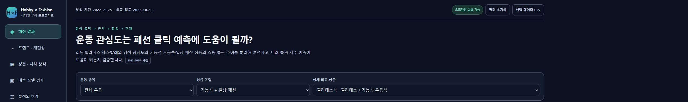

# 운동 관심도는 패션 클릭 예측에 도움이 될까

운동 검색 관심도를 패션 상품 기획과 마케팅에 활용할 수 있는지 살펴보는 시계열 분석 프로젝트입니다.

## 왜 이 분석을 했나

운동이 유행하면 관련 의류도 주목받을 수 있습니다. 하지만 검색 관심도와 상품 클릭이 함께 움직인다는 사실만으로 예측에 도움이 된다고 판단할 수는 없습니다. 이 프로젝트는 두 지표의 관계를 살펴보고, 관심도를 추가했을 때 기존 클릭 기록만 쓴 모델과 단순 예측보다 나아지는지 확인하도록 설계했습니다.

## 무엇을 검증하나

러닝·발레·필라테스·헬스 관심도와 선정한 15개 상품의 주간 클릭 지수를 비교합니다. 분석 대상은 2022~2025년이며, 양 끝의 불완전 주차를 제외합니다.

| 질문 | 확인 방법 |
|---|---|
| H1·H2: 기능성 운동복과 일상 패션은 관심도와 어떻게 움직이나 | 원지수와 52주 차분의 상품별 상관 비교 |
| H3: 관심도가 클릭보다 먼저 움직이나 | 0~8주 시차 탐색. 최고 상관만으로 선행성을 확정하지 않음 |
| H4: 헬스 관심도가 필라테스 관련 상품 예측에 추가로 도움이 되나 | 필라테스 관심도만 쓴 모델과 헬스 관심도 추가 모델의 MAE 비교 |
| H5: 관심도를 넣으면 예측이 개선되나 | 기본 Ridge·관심도 추가 Ridge·전년 동주·지속성 예측 비교 |

2024년과 2025년을 나눠 1주·4주 후 예측을 평가합니다. 매 시점에 그때까지 정답이 확인된 자료만 학습하며, 비교 모델은 같은 평가 표본을 사용합니다. 지속성 예측은 현재 값을 그대로 미래값으로 쓰는 기준입니다.

## 비즈니스에서 어떻게 활용할 수 있나

관심도는 모니터링할 상품과 시기를 정하는 후보 지표로 검토할 수 있습니다. 실제 도입은 단순 예측 대비 오차 감소, 이후 기간 재현성, 내부 구매·매출 지표를 함께 확인한 뒤 판단해야 합니다. 상관이 높거나 기존 회귀 모델이 개선됐다는 사실만으로 캠페인이나 재고 결정을 내리지 않는 것이 이 프로젝트의 판단 기준입니다.

정량 결과와 상세 인사이트는 재배포 허용 범위를 확인할 때까지 공개하지 않습니다. 현재 저장소는 분석 질문·검증 방법·코드를 보여줍니다.

## 한계

클릭은 구매나 매출이 아닙니다. 상대지수이므로 상품 간 시장 규모를 비교할 수 없습니다. 선정한 상품과 카테고리의 대표성, 누락 주차, 전체 요청 구간의 소급 정규화가 해석을 제한합니다. 현재 주 지수를 사용하는 예측은 그 주가 끝나 지수가 확정된 뒤 시행한다고 가정합니다. 시차 상관은 인과관계의 증거가 아니며, Ridge 한 구성의 결과를 모든 모델에 일반화하지 않습니다.

## 대시보드



*실제 대시보드의 제목·메뉴·필터 화면입니다. 데이터 재배포 허용 범위가 확인되지 않아 분석 수치와 차트가 담긴 영역은 공개 이미지에서 제외했습니다. 이 이미지는 실행 가능한 HTML이 아닙니다.*

분석 결과를 읽고 상품별 근거를 살펴볼 수 있도록 단일 HTML 대시보드로 정리했습니다. 핵심 결론을 먼저 보고, 관심 있는 상품의 시계열과 예측 오차를 확인하는 구성입니다.

| 화면 | 확인할 수 있는 내용 |
|---|---|
| 핵심 결과 | 분석 목적, H1~H5 판정, 2024·2025년 비교 기준별 예측 결과, 비즈니스 활용 |
| 트렌드·계절성 | 운동 관심도와 상품 클릭 추세, 월별 패턴, 상품별 연도 변화 |
| 상관·시차 분석 | 원지수와 52주 차분, 피어슨·스피어만 상관, 0~8주 시차 |
| 예측 모델 평가 | 1주·4주 후 예측, 모델별 오차, 실제 값과 예측 값, H4 비교 |
| 분석의 한계 | 지수의 의미, 관측 시점, 소급 정규화, 상품 대표성, 결측과 다중 비교 |

운동·상품 유형으로 비교 대상을 좁히고 상세 상품·기간·평가연도·예측 지평을 바꿔 살펴볼 수 있습니다. 전체 분석의 고정 결론과 현재 필터의 결과는 구분해 표시했습니다. 계절성은 각 연도 평균을 100으로 맞춘 뒤 월별 평균을 비교하며, 보고서에도 같은 기준을 적용했습니다.

2026년 10월 29일 기준 5개 화면의 13개 차트, 운동·상품 유형 15개 조합, 기간·상관 방식·예측 조건 변경, 초기화와 CSV 저장을 확인했습니다. 모바일 화면의 가로 넘침도 점검했습니다. 이 검증이 선행성·인과성이나 실제 운영 성능을 입증하는 것은 아닙니다.

대시보드는 데이터와 차트 라이브러리를 포함한 오프라인 HTML입니다. 현재는 로컬 검토용으로 보관하며, 원자료와 파생 결과의 재배포 허용 범위가 확인되기 전까지 HTML·화면 캡처·PDF를 이 저장소에 게시하지 않습니다. [GitHub Pages](https://108chang.github.io/hobby-fashion-trends/)에는 데이터가 없는 프로젝트 소개 페이지만 제공합니다.

## 실행

Python 3.11 이상에서 의존성을 설치합니다.

```bash
python -m pip install -r requirements.txt
python analyze.py
python forecast_h4_h5.py
```

허용된 로컬 데이터만 `data/processed/activity_trends.csv`와 `data/processed/shopping_trends.csv`에 배치합니다. 인증값은 `.env.example`을 참고해 로컬 `.env`에 설정합니다. `collect.py`는 외부 API 요청과 이용량을 발생시키므로 해당 서비스의 이용 자격과 약관을 확인한 뒤 실행합니다.

## 공개 범위와 확인 상태

2026년 10월 29일 기준 공개 저장소 접근과 코드·설정·데이터 없는 소개 페이지를 확인했습니다. 기존 커밋 이력도 알려진 로컬 API 인증값·토큰 패턴·개인 경로·제한 파일명 기준으로 점검했으며 해당 항목의 노출은 발견하지 못했습니다. 이 점검이 모든 종류의 비밀정보 부재를 보장하지는 않습니다.

실제 CSV, 주별 예측, PDF 보고서, 데이터 내장 대시보드, 전체 입력 ZIP은 게시하지 않습니다. NAVER 데이터랩/API HUB의 적용 계약과 원자료·파생 결과 재배포 허용 범위가 확인되지 않았기 때문입니다. [공개 범위 기준](PUBLICATION_POLICY.md)을 따릅니다.

Pages의 과거 Actions 활성화 오류는 이번 확인에서 해소했습니다. [배포 실행](https://github.com/108chang/hobby-fashion-trends/actions/runs/40796058029)이 성공했고 [소개 페이지](https://108chang.github.io/hobby-fashion-trends/)의 실제 접속도 확인했습니다. `docs/index.html`은 데이터와 필터가 없는 소개 페이지이며 분석 대시보드는 공개하지 않았습니다. 로컬 최종 대시보드의 구성과 검증 범위는 위 대시보드 항목에 정리했습니다. 로컬 검증을 공개 대시보드의 작동 확인으로 간주하지 않습니다.
